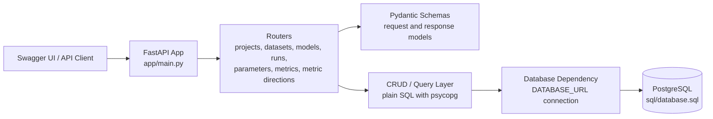
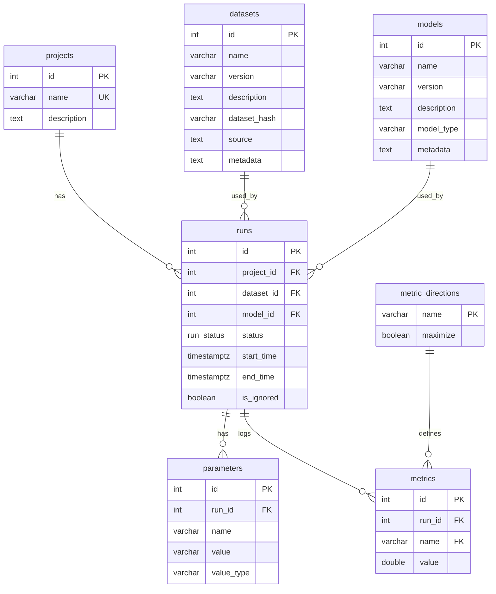
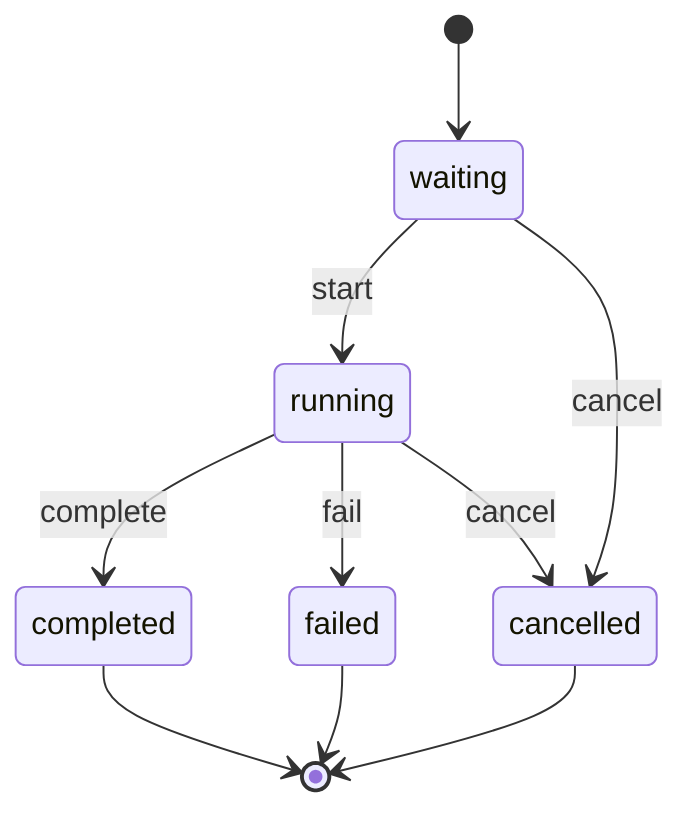
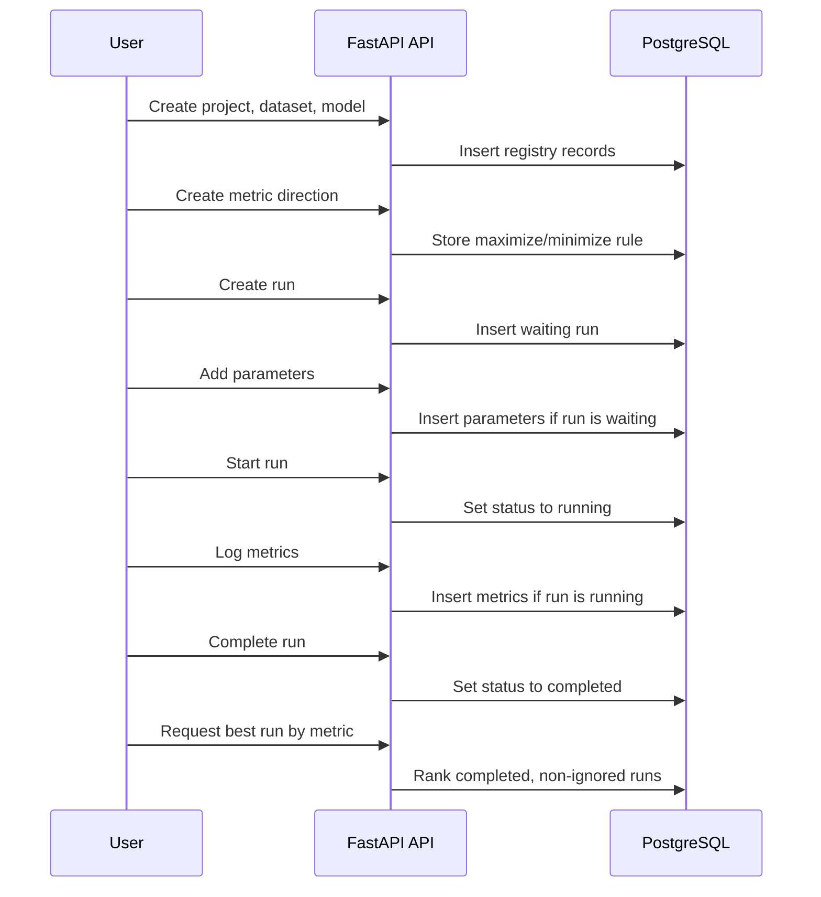

# SentinelML

A FastAPI + PostgreSQL backend for tracking, comparing, and preserving ML experiment history.

SentinelML is a learning and portfolio backend project focused on the metadata side of machine learning experimentation: projects, datasets, models, runs, parameters, metrics, metric directions, ignored runs, and best-run comparison.

It is intentionally small enough to understand, but structured around real backend concerns: API design, PostgreSQL integrity, run lifecycle rules, reproducibility thinking, and practical MLOps awareness.

**Tech stack:** Python 3.12, FastAPI, PostgreSQL, psycopg 3, Pydantic, plain SQL, Docker Compose, Swagger UI.

**Quick links**

- API docs: `http://127.0.0.1:8888/docs`
- Health check: `http://127.0.0.1:8888/health/`
- Database schema: [`sql/database.sql`](sql/database.sql)
- FastAPI entrypoint: [`app/main.py`](app/main.py)

## Overview

ML projects often involve many experiments with small differences: dataset versions, model versions, hyperparameters, metric values, and notes about why a run succeeded or failed. Without a consistent record, it becomes hard to answer simple questions like:

- Which model performed best for this project?
- Was this metric supposed to be maximized or minimized?
- Which dataset and parameters produced a result?
- Should a bad or invalid run be ignored without deleting history?

SentinelML provides a backend API for storing this experiment metadata and comparing completed runs by a chosen metric. It is designed for developers, students, reviewers, and mentors who want to see a clear backend implementation of experiment tracking concepts without the complexity of a full ML platform.

## Core Features

- Project registry for organizing experiment runs.
- Dataset registry with `(name, version)` uniqueness.
- Model registry with `(name, version)` uniqueness.
- Run lifecycle with `waiting`, `running`, `completed`, `failed`, and `cancelled` states.
- Parameters that can be added, changed, or deleted only while a run is `waiting`.
- Numeric metrics that can be added, changed, or deleted only while a run is `running`.
- Metric direction registry for `maximize` / `minimize` comparison logic.
- Ignored runs that remain stored but are excluded from best-run comparison.
- Best-run and ranked-run comparison for completed, non-ignored runs.
- Swagger UI for manual API exploration.
- PostgreSQL constraints for uniqueness, foreign keys, enum status values, and relational integrity.

## System Boundary

SentinelML is an experiment metadata tracker.

It is **not** a training runner, GPU monitor, model deployment service, real-time metric streaming system, artifact store, or full MLflow / Weights & Biases clone. It records and compares metadata about experiments that were run elsewhere.

## Architecture



## Database Overview

The database schema lives in [`sql/database.sql`](sql/database.sql). It defines the main experiment-tracking entities and protects important relationships with foreign keys and uniqueness constraints.



## Run Lifecycle

Runs begin in `waiting`. Parameters are configured before the run starts; metrics are logged while the run is running.



Important lifecycle rules:

- A new run is created as `waiting`.
- A run must have at least one parameter before it can be started.
- Parameters are locked after the run leaves `waiting`.
- Metrics are allowed only while the run is `running`.
- A run must have at least one metric before it can be completed.
- Only `waiting` runs can be deleted.
- Started runs are preserved; use `ignore` instead of deleting bad or invalid history.
- Rerunning an experiment means creating a new run.
- Ignored runs remain in the database but are excluded from comparison.

## Main API Workflow

A typical manual workflow looks like this:

1. Create a project.
2. Register a dataset.
3. Register a model.
4. Define a metric direction, such as `accuracy` with `maximize=true`.
5. Create a waiting run that links the project, dataset, and model.
6. Add one or more parameters to the waiting run.
7. Start the run.
8. Log one or more metrics while the run is running.
9. Complete, fail, or cancel the run.
10. Compare completed runs or request the best run for a metric.



## API Overview

Swagger UI is the easiest way to explore the API locally:

```text
http://127.0.0.1:8888/docs
```

Implemented endpoint groups:

| Area | Endpoints |
| --- | --- |
| Root | `GET /` |
| Health | `GET /health/`, `GET /health/db` |
| Projects | `GET /projects/`, `GET /projects/{project_id}`, `POST /projects/`, `PATCH /projects/{project_id}`, `DELETE /projects/{project_id}` |
| Project comparison | `GET /projects/{project_id}/best-run?metric_name=...`, `GET /projects/{project_id}/runs/compare?metric_name=...` |
| Datasets | `GET /datasets/`, `GET /datasets/{dataset_id}`, `POST /datasets/`, `PATCH /datasets/{dataset_id}`, `DELETE /datasets/{dataset_id}` |
| Models | `GET /models/`, `GET /models/{model_id}`, `POST /models/`, `PATCH /models/{model_id}`, `DELETE /models/{model_id}` |
| Runs | `GET /runs/`, `GET /runs/{run_id}`, `POST /runs/`, `PATCH /runs/{run_id}`, `DELETE /runs/{run_id}` |
| Run actions | `POST /runs/{run_id}/start`, `POST /runs/{run_id}/complete`, `POST /runs/{run_id}/fail`, `POST /runs/{run_id}/cancel`, `POST /runs/{run_id}/ignore`, `POST /runs/{run_id}/unignore` |
| Parameters | `GET /runs/{run_id}/parameters/`, `GET /runs/{run_id}/parameters/{parameter_id}`, `POST /runs/{run_id}/parameters/`, `PATCH /runs/{run_id}/parameters/{parameter_id}`, `DELETE /runs/{run_id}/parameters/{parameter_id}` |
| Metrics | `GET /runs/{run_id}/metrics/`, `GET /runs/{run_id}/metrics/{metric_id}`, `POST /runs/{run_id}/metrics/`, `PATCH /runs/{run_id}/metrics/{metric_id}`, `DELETE /runs/{run_id}/metrics/{metric_id}` |
| Metric directions | `GET /metric-directions/`, `GET /metric-directions/{metric_name}`, `POST /metric-directions/`, `PATCH /metric-directions/{metric_name}`, `DELETE /metric-directions/{metric_name}` |

## Business Rules and Integrity

Rules enforced by the database and application code:

- Project names are unique.
- Dataset `(name, version)` pairs are unique.
- Model `(name, version)` pairs are unique.
- Run status is constrained by a PostgreSQL enum: `waiting`, `running`, `completed`, `failed`, `cancelled`.
- Runs default to `waiting` and `is_ignored=false`.
- A run must reference an existing project, dataset, and model.
- Dataset and model on a run can only be changed while the run is `waiting`.
- A run must have at least one parameter before it can start.
- Parameters are unique per run by `(run_id, name)`.
- Parameters can only be created, updated, or deleted while the run is `waiting`.
- Metrics are unique per run by `(run_id, name)`.
- Metric values are numeric floating-point values.
- A metric direction must exist before logging a metric with that name.
- Metrics can only be created, updated, or deleted while the run is `running`.
- A run must have at least one metric before it can be completed.
- Failed runs require a reason through the fail endpoint.
- Cancelled runs can store an optional reason.
- Completed, non-ignored runs are used for comparison.
- Best-run comparison sorts ascending or descending based on the metric direction.
- Projects, datasets, models, and metric directions cannot be deleted while referenced by existing records.
- Only `waiting` runs can be deleted; started runs should be ignored instead.
- Metric directions cannot be updated or deleted after metrics use them.

## Installation and Setup

### Option 1: Run with Docker Compose

Docker Compose is the simplest setup because it starts PostgreSQL and initializes the schema automatically from [`sql/database.sql`](sql/database.sql).

```bash
docker compose up -d --build
```

Or use the Makefile:

```bash
make build
```

Then open:

```text
http://127.0.0.1:8888/docs
```

Useful Docker commands:

```bash
make up      # start containers
make down    # stop containers
make clean   # stop containers and remove volumes
make ps      # show compose containers
make shapp   # open a shell in the app container
```

### Option 2: Run Locally with Python

Requirements:

- Python 3.12+
- PostgreSQL
- A database created for SentinelML

Create a virtual environment and install dependencies:

```bash
python -m venv .venv
source .venv/bin/activate
pip install -r requirements.txt
```

Create a local environment file:

```bash
cp .env.example .env.local
```

Edit `.env.local` so `DATABASE_URL` points to your local PostgreSQL database.

Load the environment variables into your shell:

```bash
set -a
source .env.local
set +a
```

Apply the schema:

```bash
psql "$DATABASE_URL" -f sql/database.sql
```

Start the API:

```bash
make start
```

Equivalent direct command:

```bash
uvicorn app.main:app --reload --host 127.0.0.1 --port 8888
```

## Environment Variables

The app reads environment variables with `python-dotenv` in [`app/database.py`](app/database.py).

| Variable | Purpose |
| --- | --- |
| `APP_ENV` | Selects which `.env.{APP_ENV}` file to load. Defaults to `local`, so `.env.local` is used when present. |
| `DATABASE_URL` | PostgreSQL connection string used by psycopg. |
| `POSTGRES_USER` | PostgreSQL user, used by Docker Compose and local env examples. |
| `POSTGRES_PASSWORD` | PostgreSQL password, used by Docker Compose and local env examples. |
| `POSTGRES_DB` | PostgreSQL database name, used by Docker Compose and local env examples. |
| `POSTGRES_MACHINE` | Database host name. In Docker, this is `db`; locally, this is usually `localhost`. |
| `POSTGRES_PORT` | PostgreSQL port, usually `5432`. |

The repository includes `.env.example`, `.env.local`, and `.env.docker`. For personal or shared projects, prefer replacing committed local credentials with a sanitized example file.

## Swagger Usage

SentinelML is designed to be easy to test through Swagger UI:

```text
http://127.0.0.1:8888/docs
```

Swagger provides request forms for each route and displays the Pydantic response models. This is the recommended way to manually explore the API during development.

## Example Manual Test Scenario

Using Swagger UI:

1. Create a project, for example an image classification experiment.
2. Create a dataset with a name and version.
3. Create a model with a name and version.
4. Create a metric direction named `accuracy` with `maximize=true`.
5. Create a run linked to the project, dataset, and model.
6. Add parameters such as `learning_rate`, `batch_size`, or `epochs`.
7. Start the run.
8. Add an `accuracy` metric while the run is running.
9. Complete the run.
10. Request the project best run with `metric_name=accuracy`.

If a run produces invalid results, mark it as ignored instead of deleting it. The record stays available for history, but comparison excludes it.

## Project Structure

```text
.
├── app
│   ├── crud
│   │   ├── datasets.py
│   │   ├── metric_directions.py
│   │   ├── metrics.py
│   │   ├── models.py
│   │   ├── parameters.py
│   │   ├── projects.py
│   │   └── runs.py
│   ├── routers
│   │   ├── datasets.py
│   │   ├── health.py
│   │   ├── metric_directions.py
│   │   ├── metrics.py
│   │   ├── models.py
│   │   ├── parameters.py
│   │   ├── projects.py
│   │   └── runs.py
│   ├── schemas
│   │   ├── datasets.py
│   │   ├── metric_directions.py
│   │   ├── metrics.py
│   │   ├── models.py
│   │   ├── parameters.py
│   │   ├── projects.py
│   │   └── runs.py
│   ├── database.py
│   └── main.py
├── sql
│   └── database.sql
├── docker-compose.yaml
├── Dockerfile
├── Makefile
├── pyproject.toml
├── requirements.txt
└── uv.lock
```

## Design Notes

**Plain SQL over an ORM:** SentinelML uses explicit SQL through psycopg. This makes database behavior visible and keeps the project focused on schema design, constraints, transactions, and query logic.

**PostgreSQL as a source of integrity:** Unique constraints, foreign keys, enum statuses, and cascading behavior are part of the database design instead of being handled only in Python.

**Lifecycle-aware runs:** Parameters and metrics are not treated as generic mutable records. Parameters belong to setup time; metrics belong to execution time. This keeps experiment records easier to reason about.

**Ignored runs instead of deletion:** Bad runs are part of experiment history. Marking them ignored protects comparison results while preserving context for later review.

## Known Limitations

- No authentication or user/workspace model.
- No frontend UI beyond Swagger.
- No automated test suite is currently present.
- No CI pipeline is currently configured.
- No pagination or filtering on list endpoints.
- No artifact storage for model files, logs, plots, or datasets.
- No training runner integration.
- No real-time metric streaming.
- No deployment configuration beyond Docker Compose for local development.
- Local credential files are present; shared repositories should keep only sanitized examples.

## Future Improvements

- Add authentication and workspace/team ownership.
- Add an automated test suite for CRUD rules, lifecycle transitions, and comparison behavior.
- Add pagination, filtering, and sorting for list endpoints.
- Add artifact metadata for files produced by training jobs.
- Add CSV or JSON export for project experiment history.
- Add optional integration examples for training scripts.
- Add support for LLM evaluation runs and evaluator-specific metrics.
- Add CI checks for linting, formatting, tests, and Docker build validation.
- Add screenshots or short walkthrough GIFs for Swagger workflows.
- Polish Docker configuration for clearer local and production separation.

## License

No license file is currently included in this repository.
