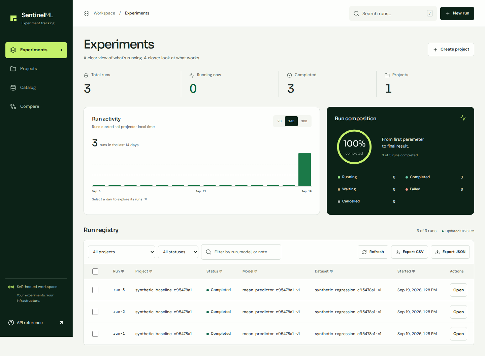
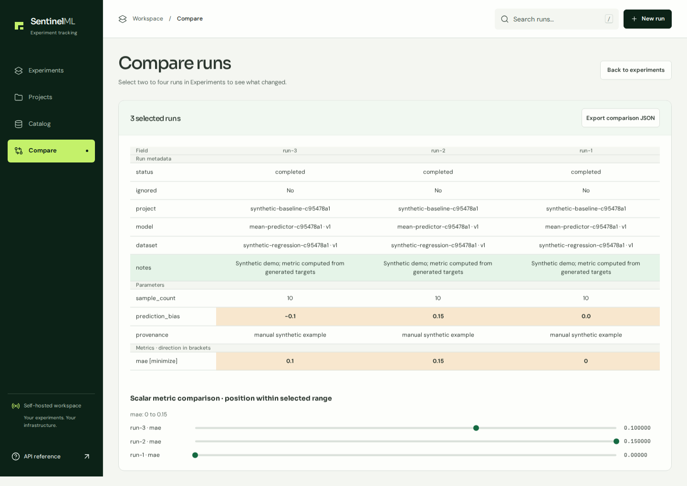

# SentinelML

Local experiment tracking for machine learning.

SentinelML keeps the parameters, dataset and model versions, notes, and results
of your experiments in one place. Record a run from Python, inspect it in the
browser, and compare it with earlier runs. Your history lives in PostgreSQL on
your own machine.

[Get started](#get-started) · [Usage guide](docs/USAGE.md) · [API reference](docs/API.md) · [Contributing](CONTRIBUTING.md)

> **0.1 preview.** Built for one trusted user on localhost. Authentication and
> schema migrations are not available yet. See [current limits](#current-limits).

## Get started

You need Docker with **Docker Compose 2.24 or newer**. From the repository root:

```sh
docker compose up -d --build --wait
```

Open **[http://127.0.0.1:8888/ui/](http://127.0.0.1:8888/ui/)**. Compose starts the
application, PostgreSQL, and Redis using the included local defaults. No account,
frontend build, or environment-file setup is needed for the default stack.

To populate the workspace, run this optional example with **Python 3.12 or newer**:

```sh
python3 -m examples.track_experiment
```

You should see three completed runs with MAE values of `0.0000`, `0.1500`, and
`0.1000`. Refresh the dashboard, check two run rows, and open **Compare** to see
what changed. The example uses synthetic data and no third-party Python packages.



*The dashboard after running the included example. All data shown is synthetic.*

Stop the stack with `docker compose down`; your experiment history stays in its
named database volume. For configuration, backups, native Python setup, or a busy
port, see the [setup guide](docs/SETUP.md).

## Record your first experiment

Run this Python example from the repository root while the server is running.
You can also copy [sentinelml_client.py](sentinelml_client.py) alongside your
training script; it uses only the Python standard library.

```python
from uuid import uuid4
from sentinelml_client import SentinelMLClient

client = SentinelMLClient()
tag = uuid4().hex[:8]
project = client.create_project(f"baseline-{tag}")
dataset = client.create_dataset(f"synthetic-{tag}", "v1")
model = client.create_model(f"constant-predictor-{tag}", "v1")
client.ensure_metric_direction("mae", maximize=False)

run = client.create_run(project["id"], dataset["id"], model["id"])
client.add_parameter(run["id"], "prediction", 2.0)

with client.experiment_run(run["id"]) as experiment:
    targets = [1.0, 2.0, 3.0]
    mae = sum(abs(target - 2.0) for target in targets) / len(targets)
    experiment.log_metric("mae", mae)

print(f"Completed run {run['id']}: MAE = {mae:.4f}")
```

The context manager starts and completes the run. If the body raises, it attempts
to mark the run failed and preserves the original exception. Put your training
and evaluation code inside that block, and log the resulting scalar metrics.

Parameters are recorded before a run starts; metrics are recorded while it runs.
A run needs at least one of each to reach completion. Logging the same metric
again updates its value. The [usage guide](docs/USAGE.md) covers manual tracking,
run states, comparison, and exports.

## Inside the workspace

| Feature | Use it to |
| --- | --- |
| Projects | Group runs around a question or task |
| Dataset and model catalog | Register versions and attach context to each run |
| Run history | See waiting, running, completed, failed, and cancelled experiments |
| Comparison | Inspect parameter and metric differences side by side |
| Metric directions | Rank completed runs using explicit minimize/maximize rules |
| Ignore with a reason | Exclude a result from rankings while keeping its record |
| CSV and JSON export | Export the filtered run list and its basic metadata |



*Comparison preserves the context behind a score; ignored runs stay in history.*

## Current limits

This preview fits individual work and small experiment histories.

- **Local access:** anyone who can reach the API can read and modify its data.
  Keep it on localhost. For access to your own remote instance, use the
  [HTTPS gateway guide](docs/DEPLOYMENT.md).
- **Scalar results:** no metric time series, artifact storage, autologging, or
  automatic capture of code and environment versions.
- **Fresh installations:** no supported schema upgrades. Back up PostgreSQL
  before changing versions. CSV/JSON exports are not database backups.
- **Small histories:** lists are unpaginated and browser filtering loads the data.
- **Editable metadata:** notes and ignore status remain editable after completion;
  dataset and model records can also change.

See the [roadmap](docs/ROADMAP.md) for proposed work and the
[release policy](docs/RELEASES.md) for compatibility details.

## Development

The server uses Python 3.12, FastAPI, SQLAlchemy, PostgreSQL 16, and optional Redis
caching. The dashboard is plain HTML, CSS, and JavaScript with bundled assets.

```sh
uv sync --locked
make lint
make test
```

[Contributing](CONTRIBUTING.md) explains the development and test workflows.
[Architecture](docs/ARCHITECTURE.md) maps the code and domain rules.
[Changelog](CHANGELOG.md) records user-visible changes.

## License

Apache License 2.0. See [LICENSE](LICENSE) and [third-party notices](NOTICE).
Contributors follow the [Code of Conduct](CODE_OF_CONDUCT.md).
Report vulnerabilities using the guidance in [SECURITY.md](SECURITY.md).
