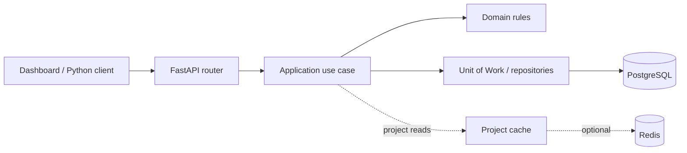
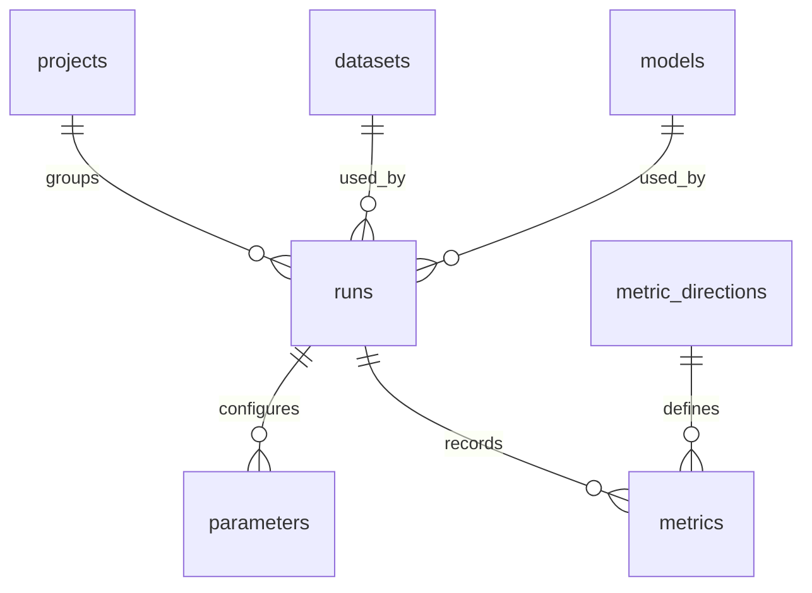

# Architecture

[README](../README.md) / [Contributing](../CONTRIBUTING.md) / Architecture

SentinelML separates entity rules, application workflows, and infrastructure.
The HTTP API and browser dashboard use the same application behavior. PostgreSQL
stores experiment history; Redis caches individual project reads.

## Request path

A router validates the request shape and builds a command. A use case checks
references and workflow rules, applies changes to domain entities, and commits
through the Unit of Work. Application errors are translated into HTTP responses.
The domain imports no HTTP or database framework.

## Data model

A run belongs to one project and references one dataset and model. Dataset/model
records describe versions; they are not uploaded files. Parameters are strings
with an optional type label, and each metric is one finite numeric value.

PostgreSQL enforces unique project names, unique dataset/model `(name, version)`
pairs, unique parameter/metric names within a run, and foreign-key references.
Metric directions use the metric name as their key. The schema is in
[sql/database.sql](../sql/database.sql), with corresponding SQLAlchemy models in
[app/infrastructure/postgres/orm_models](../app/infrastructure/postgres/orm_models).

## Lifecycle and transactions

[Run states](USAGE.md#run-states) determine which operations are allowed. The main
rules live in [app/domain/runs.py](../app/domain/runs.py). Starting requires a
parameter; completing requires a metric. Notes and ignore state can still change
after a terminal state.

Mutation use cases lock relevant rows with `SELECT ... FOR UPDATE` before changing
them. Run-related writes coordinate through the run row; this is not a global
application lock. A failed use case rolls back, and the Unit of Work closes its
session. Foreign keys and uniqueness constraints remain the database-level guard
against conflicting references and duplicates.

Read [the lifecycle use cases](../app/application/use_cases/runs/lifecycle.py),
[the SQLAlchemy Unit of Work](../app/infrastructure/postgres/unit_of_work.py), and
[run repositories](../app/infrastructure/postgres/repositories/runs.py) for that path.

Rankings join runs, metrics, and directions, include only completed/non-ignored
runs, and order by metric value and then run ID. Dataset/model equivalence is not
checked by the ranking query.

## Project caching

Individual project reads use a cache-aside path: try Redis, load from PostgreSQL
on a miss, then populate the cache. Project creation populates the cache; update
and delete invalidate it after the database commit. Project list reads use
PostgreSQL directly.

[ResilientProjectCache](../app/infrastructure/redis/project_cache.py) handles
supported Redis and deserialization failures as cache misses on reads. Cache
writes and invalidations are best-effort; a failed invalidation can leave a cached
value until its TTL expires. PostgreSQL remains the durable source of truth.
With no `REDIS_URL`, a no-op cache is used.

## Where to change something

| Concern | Start here |
| --- | --- |
| Entity validation or run rules | [app/domain](../app/domain) |
| Start, complete, rank, or another workflow | [app/application/use_cases](../app/application/use_cases) |
| Repository/cache/clock interfaces | [app/application/ports](../app/application/ports) |
| SQLAlchemy queries, mapping, and transactions | [app/infrastructure/postgres](../app/infrastructure/postgres) |
| Redis behavior | [app/infrastructure/redis](../app/infrastructure/redis) |
| HTTP routes and request/response schemas | [app/presentation/api](../app/presentation/api) |
| Dashboard rendering and interactions | [app/web](../app/web) |
| Dependency wiring | [app/bootstrap.py](../app/bootstrap.py) |
| Environment configuration | [app/config.py](../app/config.py) |
| Server startup and static routes | [app/main.py](../app/main.py) |

Use [Contributing](../CONTRIBUTING.md) for development and verification commands.
Authentication, schema migrations, and paginated history queries remain outside
the current preview; see [Roadmap](ROADMAP.md).
