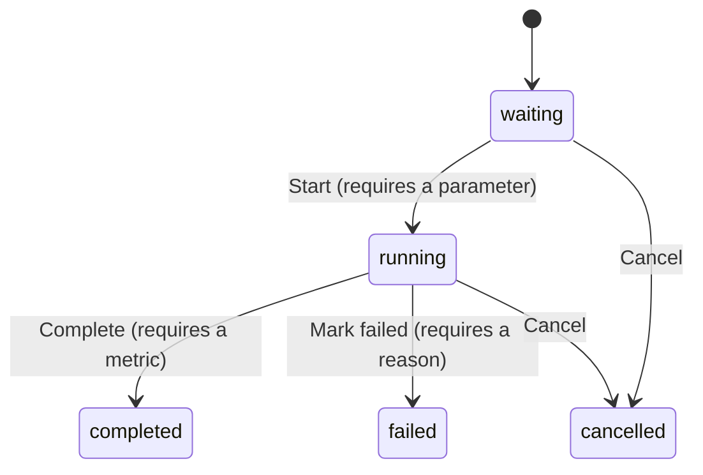

# Using SentinelML

[README](../README.md) / Usage

Start the server with the [setup guide](SETUP.md), then open
`http://127.0.0.1:8888/ui/`. Use the dashboard for manual tracking and the Python
client for scripts. Both use the same API and run lifecycle.

## Try a populated workspace

From the repository root, with Python 3.12 or newer:

```sh
python3 -m examples.track_experiment
```

For a different port or instance:

```sh
python3 -m examples.track_experiment --url http://127.0.0.1:8889
```

The example creates one project, a dataset version, a model version, and three
completed runs. Each run changes `prediction_bias`; its MAE is `0.0000`, `0.1500`,
or `0.1000`. Records are synthetic and stay in your database. Repeating the command
creates a new project with a unique suffix.

Refresh the dashboard, select two run rows, and open **Compare**. You can inspect
the recorded parameters and results without training a model or downloading data.

## Track an experiment in the dashboard

1. Create a **project** for the task you are investigating.
2. In **Catalog**, register a dataset and model with their versions. These are
   metadata records; SentinelML does not upload the dataset or model files.
3. Add a **metric direction** in Catalog. Choose **Minimize** for a loss or MAE,
   or **Maximize** for accuracy. Use the same metric name when logging results.
4. Click **New run**, then choose the project, dataset, and model.
5. Open the run and add its parameters, such as `learning_rate` or `seed`.
6. Click **Start run**. Add scalar metrics as results become available.
7. Click **Complete** when the result is final. At least one metric is required.

The empty workspace guides you through metric registration before your first run.
In a running run's **Metrics** panel, choose a registered metric name or click
**Register a metric** to add its minimize/maximize direction.

Use **Edit** beside a parameter or metric to correct its name or value, then
**Save**. **Cancel edit** leaves the stored value unchanged. Parameters can be
edited only while waiting; metrics only while running. **Add** creates a new
entry; it does not overwrite an existing name.

Unsaved run notes stay in memory when navigating between views or changing run
state. Click **Save notes** to persist them. Reloading or closing the page warns
while drafts remain; leaving anyway discards them.

Use **Mark failed** for a running experiment that failed, or **Cancel** for a
waiting/running experiment you will not finish. Keep the reason with the run.

## Track from Python

The [README example](../README.md#record-your-first-experiment) creates its own
resources and records one result. Run it from the checkout or copy
[sentinelml_client.py](../sentinelml_client.py) next to your training script.
The client uses only the Python standard library and is also included in the wheel.

To repeat an experiment, reuse the returned project, dataset, and model IDs and
create another run. Change the parameters before starting it:

```python
# Continue after the README example; client, project, dataset, and model exist.
run = client.create_run(project["id"], dataset["id"], model["id"])
client.add_parameter(run["id"], "prediction", 2.5)

with client.experiment_run(run["id"]) as experiment:
    targets = [1.0, 2.0, 3.0]
    mae = sum(abs(target - 2.5) for target in targets) / len(targets)
    experiment.log_metric("mae", mae)

print(f"Completed run {run['id']}: MAE = {mae:.4f}")
print(f"Project ID for comparison: {project['id']}")
```

`experiment_run` starts the waiting run on entry and completes it on normal exit.
If the body raises, it attempts to mark the run failed and preserves that exception
if the failure update also fails. If completion itself fails, the exception is
returned to the caller; the client does not claim success or retry writes.

Repeated logging of a metric updates its single scalar value. It does not retain
intermediate steps. Names are trimmed consistently, including when logging again.
The default request timeout is 10 seconds; set `timeout=` on `SentinelMLClient`
for another value. The client does not train or evaluate your model for you.

## Compare and rank results

**Side-by-side comparison** shows the runs you select in the dashboard. Check the
model, dataset, and parameter differences before interpreting their scores.

**Ranking** is an API operation within one project. It includes only completed,
non-ignored runs that contain the requested metric. The metric direction controls
ascending/descending order; equal values are ordered by run ID.

Use the project ID printed by your script:

```sh
# Replace 123 with your project ID.
PROJECT_ID=123
curl --fail-with-body --silent --show-error \
  "http://127.0.0.1:8888/projects/$PROJECT_ID/runs/compare?metric_name=mae"
```

Use `/projects/$PROJECT_ID/best-run?metric_name=mae` for the first ranked run.
Ranking requests return an application error when there are no eligible runs.
SentinelML does not check that runs use comparable data or evaluation procedures.

**Ignore** a run with a reason to exclude it from rankings while retaining its
history. Ignore status is independent of lifecycle state and can be reversed.

## Run states



| State | Parameters | Metrics | Change dataset/model | Delete run |
| --- | --- | --- | --- | --- |
| `waiting` | Add, update, delete | Unavailable | Yes | Yes |
| `running` | Locked | Add, update, delete | No | No |
| `completed` | Locked | Locked | No | No |
| `failed` | Locked | Locked | No | No |
| `cancelled` | Locked | Locked | No | No |

Terminal runs cannot be restarted or deleted through the API. Create a new run
for another attempt. Notes and ignore status remain editable in every state;
a failure/cancellation reason can be edited after that transition. Dataset/model
catalog metadata also remains mutable, so recorded history is not immutable.

## Export and recovery

In **Experiments**, set the project, status, search, and activity filters you want,
then use **Export CSV** or **Export JSON**. These export the currently filtered run
rows and basic metadata. They do not include the full parameter/metric tables,
catalog, or database schema.

For complete recovery, use a [PostgreSQL backup](SETUP.md#back-up-your-history).
Keep exported files and backups private when they contain sensitive research data.

## More detail

- [HTTP API reference](API.md): endpoints, field limits, errors, and update behavior.
- [Setup](SETUP.md): ports, environment files, backups, and troubleshooting.
- [Architecture](ARCHITECTURE.md): domain rules, transactions, and source layout.
